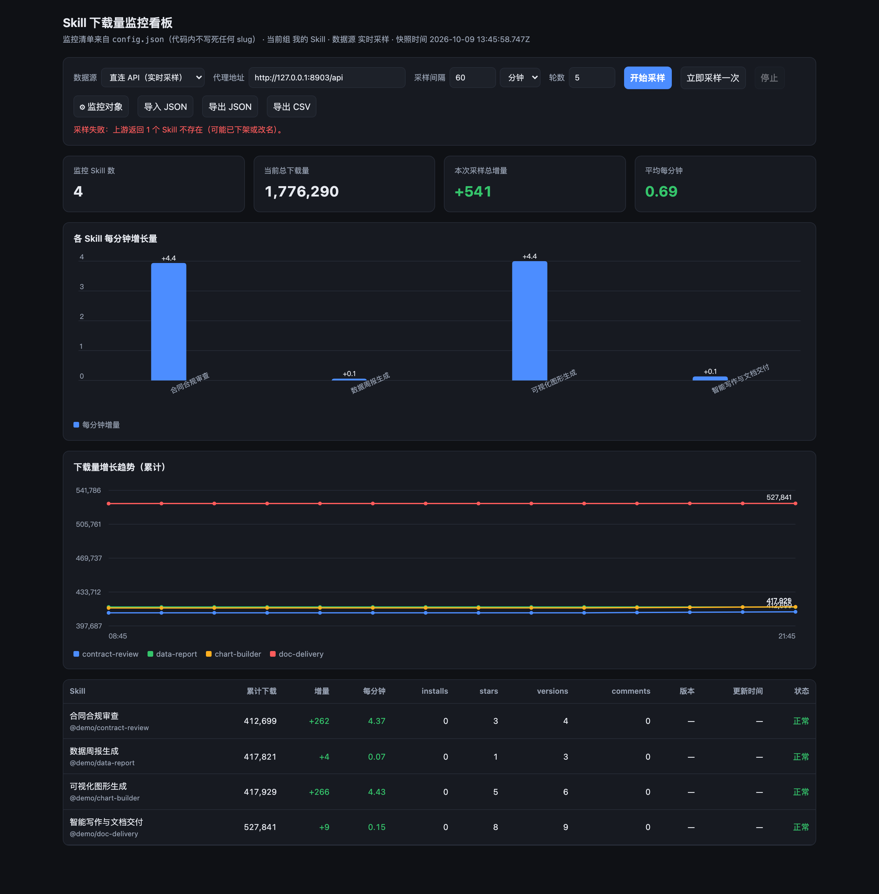
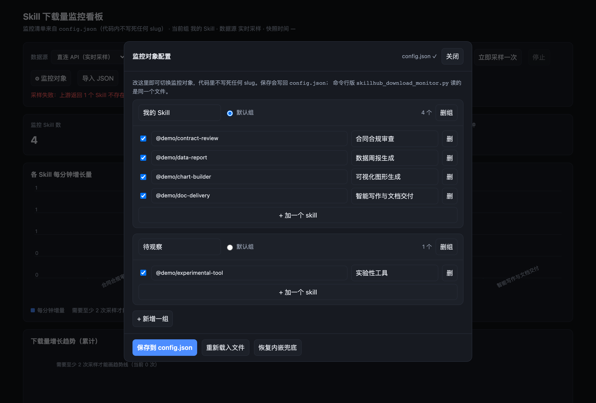

# SkillHub 下载量监控看板

监控 SkillHub 上任意 Skill 的**下载量、增长量、累计趋势**。双击启动，本地打开浏览器就能用。



---

## 为什么需要它

SkillHub 的接口只返回**累计下载量**，**没有历史趋势接口**。想知道"涨了多少"，只能自己定时采样、再做差分：

```
每分钟增长 = (本次 downloads − 上次 downloads) / 两次采样间隔(分钟)
```

这个工具把这个流程做完了：起服务 → 定时采样 → 差分 → 出图表 → 导出 CSV/JSON。**监控对象写在配置文件里，不改代码。**

## 特性

- **配置驱动** — 监控对象写在 `config.json`，页面上可直接增删改并保存回文件，不改代码
- **一键启动** — macOS 双击 `启动看板.command`，Windows 双击 `start.bat`
- **零配置** — 无需注册、无需数据库、无需登录SkillHub 账号
- **自动过CORS** — 内置本地代理，解决 SkillHub 只放行自家域名导致的浏览器跨域拦截
- **多 Skill 对比** — 分组管理，多条折线同图对比
- **已下架识别** — slug 失效时明确标记「已下架」，不会静默算成 0
- **导出** — CSV / JSON，含全部样本与增量，可再导入回看历史
- **命令行版** — `skillhub_download_monitor.py`，可挂cron / 定时任务长期累积

## 快速开始

### macOS

```bash
git clone <this-repo>
cd skillhub-monitor
双击 启动看板.command
```

或者终端：

```bash
./start.sh                # 默认 8787
./start.sh --port 9000    # 换端口
```

### Windows

双击 `start.bat`。

### Linux

```bash
./start.sh
```

首次运行会自动创建 venv 并装 `requests`（约 10 秒），之后秒开。

> 需要 Python 3.8+。浏览器会自动打开 `http://127.0.0.1:8787`。

## 配置监控对象

### 方式一：在页面上改（推荐）

点工具栏 **「⚙ 监控对象」** → 增删 skill / 切默认组 / 勾选临时跳过 / 改采样参数 → 点「保存到 config.json」。

保存是**原子写**（先写临时文件再替换），且会校验结构，坏配置不会写坏原文件。



### 方式二：直接编辑 `config.json`

```json
{
  "settings": { "interval": 60, "rounds": 5, "unit": "min", "mode": "live" },

  "groups": [
    {
      "name": "我的 Skill",
      "enabled": true,
      "skills": [
        { "slug": "@your-org/your-skill", "name": "显示名", "enabled": true }
      ]
    }
  ]
}
```

| 字段 | 说明 |
| --- | --- |
| `settings.interval` / `rounds` / `unit` | 默认采样参数（间隔秒数 / 轮数 / 分钟或秒），页面上可临时覆盖 |
| `groups[].name` | 组名，显示在页面上 |
| `groups[].enabled` | `true` = 当前默认组 |
| `groups[].skills[].slug` | **必填**，SkillHub 的 `canonicalName`，形如 `@org-xxx/yyy` 或 `@user-xxx/yyy` |
| `groups[].skills[].name` | 显示名，留空则用 slug 末段 |
| `groups[].skills[].enabled` | `false` = 临时跳过这一条，不参与采样 |

**怎么找 slug**：在 SkillHub 上打开 skill 详情页，URL 里 `@xxx/yyy` 的部分就是。

## 怎么读这些数字

| 指标 | 含义 |
| --- | --- |
| **累计下载** | 平台返回的当前累计值 |
| **增量** | 相邻两次采样的差值 |
| **每分钟** | 增量 ÷ 采样间隔（分钟） |
| **installs** | 平台安装数（多数 skill 为 0，不是真实使用量） |
| **stars** | 用户评星数 —— **比下载量更接近真实需求** |

> ⚠️ **建议别盯下载量**。刷量能让数字很好看，但带来的是零商机。
> `stars` / `comments` / 版本迭代频率更能说明真实使用。

**采样节奏建议**：这类指标变化很慢，分钟级采样基本没意义（会看到大量 0）。
用长周期累积才有斜率：

```bash
# 每天采一次，攒 30 天
python skillhub_download_monitor.py --interval 86400 --rounds 30 --csv growth.csv
```

## 命令行版

监控对象同样读 `config.json`，代码内不写死任何 slug。

```bash
python skillhub_download_monitor.py                        # 用默认组
python skillhub_download_monitor.py --group "另一组"      # 指定组
python skillhub_download_monitor.py --slug "@org-x/y"     # 临时指定，覆盖配置
python skillhub_download_monitor.py --interval 3600 --rounds 24 --csv growth.csv
```

| 参数 | 说明 | 默认 |
| --- | --- | --- |
| `--config` | 配置文件路径 | 同目录 `config.json` |
| `--group` | 用哪一组 | `enabled=true` 的组 |
| `--slug` | 临时指定 slug，可重复 | 用配置的清单 |
| `--interval` | 采样间隔秒数 | 配置 `settings.interval` |
| `--rounds` | 采样轮数 | 配置 `settings.rounds` |
| `--csv` | 写入 CSV | 不写 |

挂到 cron（每天 09:00 采一次）：

```cron
0 9 * * * cd /path/to/skillhub-monitor && .venv/bin/python3 skillhub_download_monitor.py --interval 86400 --rounds 1 --csv daily.csv >> monitor.log 2>&1
```

## 用的接口

| 用途 | 方法 | 地址 |
| --- | --- | --- |
| 批量取多个 Skill | POST | `https://api.skillhub.cn/api/v1/skills/batch` |
| 单个 Skill 详情 | GET | `https://api.skillhub.cn/api/v1/skills/{publicSlug}` |
| 关键词搜索 | GET | `https://api.skillhub.cn/api/v1/search?q=xxx&limit=50` |

批量接口返回 `items[].skill.stats`：

```json
{ "downloads": 412167, "installs": 0, "stars": 1, "versions": 0, "comments": 0 }
```

> **关于趋势接口**：穷举验证过，SkillHub 没有公开的下载量历史接口，所有统计字段都是当前快照。
> `sortBy=trending` 明确拒绝，`/dashboard/skills` 和 `/orgs/*/skills` 需登录鉴权。
> 所以趋势只能靠自采累积 —— 这正是本工具存在的原因。

## 文件

| 文件 | 说明 |
| --- | --- |
| `启动看板.command` | macOS 双击一键启动 |
| `start.sh` | 一键启动（macOS / Linux） |
| `start.bat` | 一键启动（Windows） |
| `dashboard.html` | 看板本体，含「⚙ 监控对象」配置面板 |
| `serve.py` | 本地服务 + CORS 代理 + 配置回写 |
| `skillhub_download_monitor.py` | 命令行监控，读同一份 `config.json` |
| `config.json` | **监控清单配置（改这个，不改代码）** |

## 实现要点

**为什么需要本地代理**：SkillHub 的 CORS 只放行 `skillhub.cn`，浏览器直连 `api.skillhub.cn` 会被拦。
`serve.py` 把 `/api/*` 反向代理到上游，页面与代理同源，绕开跨域。

**为什么采样失败不终止**：上游会偶发 SSL 断连。原实现失败即退出，导致经常"跑几轮就停"。
现改为失败重试，连续失败超过 3 次才停。

**配置面板的 DOM 顺序**：配置面板必须写在主 `<script>` **之前**。
否则脚本执行时元素尚未创建，事件绑定会抛
`Cannot set properties of null (setting 'onclick')`。

**图表标签**：取显示名末段（`shortLabel()`），避免"某某公司某某模块"这种长前缀挤掉图表空间。

## 免责声明

本工具仅做数据可视化，不做任何平台数据的抓取代理或二次分发。
请遵守目标平台的使用条款，控制采样频率（**不建议分钟级长期采样**）。

## License

MIT — 见 [LICENSE](LICENSE)。